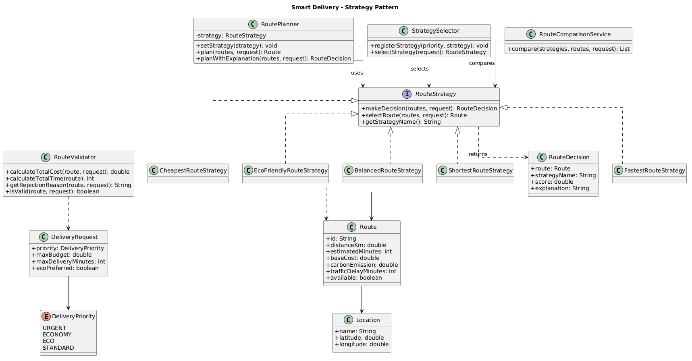
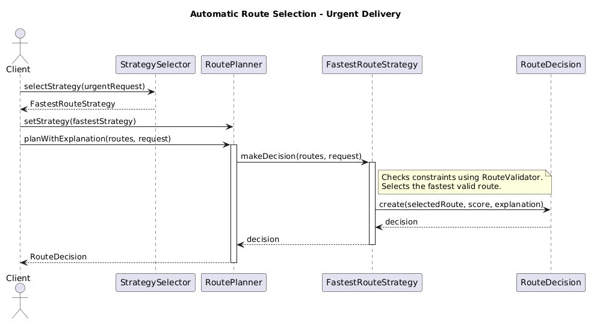

# Assignment 5 - Smart Delivery & Route Optimization Engine

**Student:** Satybaldy Amina  
**Group:** SE-2517  

## 1. Project Description

This project is a simple delivery route optimization system.

The system helps a delivery company choose a suitable route for an order. Different customers may have different needs. Some customers want fast delivery, while others prefer a cheaper or more eco-friendly route.

I used the Strategy Pattern because the program needs several route selection algorithms.

The user can change the strategy while the program is running.

## 2. Project Features

- Five route selection strategies
- Eight example delivery routes
- Runtime strategy switching
- Automatic strategy selection
- Budget and delivery time restrictions
- Route availability checking
- Comparison between strategies
- Explanation of the selected route
- Exception handling
- JUnit 5 tests

## 3. Strategy Pattern Architecture

The project has three main parts:

**Context:** `RoutePlanner`

The RoutePlanner stores the current strategy and uses it to select a route.

**Strategy Interface:** `RouteStrategy`

This interface defines the common methods for route selection.

**Concrete Strategies:**

1. `FastestRouteStrategy`
2. `CheapestRouteStrategy`
3. `EcoFriendlyRouteStrategy`
4. `BalancedRouteStrategy`
5. `ShortestRouteStrategy`

All strategies implement the same interface, but each strategy selects routes using different rules.

## 4. Route Selection Algorithms

### FastestRouteStrategy

This strategy selects the route with the shortest total delivery time.

Formula:

Total Time = Estimated Time + Traffic Delay

For example, if a route needs 20 minutes and has a traffic delay of 5 minutes:

Total Time = 20 + 5 = 25 minutes

The strategy also checks budget, deadline, and route availability.

### CheapestRouteStrategy

This strategy selects the route with the lowest total cost.

Formula:

Total Cost = Base Cost + (Distance × 100) + Priority Surcharge

For urgent deliveries, the priority surcharge is 500 KZT.

For example:

Base Cost = 1100 KZT  
Distance = 9 km  
Priority = STANDARD

Total Cost = 1100 + (9 × 100) + 0 = 2000 KZT

### EcoFriendlyRouteStrategy

This strategy selects the route with the lowest environmental impact.

Formula:

Eco Score = 0.7 × Normalized Emission + 0.3 × Normalized Distance

Lower scores are better.

I used a higher weight for carbon emissions because this strategy focuses on the environment.

This calculation belongs inside EcoFriendlyRouteStrategy because it is the algorithm used to select an eco-friendly route.

### BalancedRouteStrategy

This strategy considers four factors together:

- Delivery time
- Delivery cost
- Distance
- Carbon emissions

Formula:

Score = (Normalized Time × Time Weight)
+ (Normalized Cost × Cost Weight)
+ (Normalized Distance × Distance Weight)
+ (Normalized Emission × Emission Weight)

Default weights:

- Time: 0.40
- Cost: 0.30
- Distance: 0.10
- Emissions: 0.20

The sum of all weights must equal 1.0.

If the weights are invalid, the program throws an IllegalArgumentException.

All values are normalized so that different units can be compared.

The route with the lowest score is selected.

### ShortestRouteStrategy

I added this strategy after implementing the first four strategies.

It selects the route with the minimum distance in kilometers.

It also checks all hard constraints before selecting a route.

This strategy demonstrates that a new algorithm can be added without changing the RoutePlanner logic.

## 5. Hard Constraints

The system checks whether a route can be used before comparing its score.

A route is rejected if:

1. The route is unavailable.
2. Its total cost exceeds the customer's budget.
3. Its total delivery time exceeds the deadline.

For example, a route can be very fast, but if it exceeds the budget, it cannot be selected.

If no routes are suitable, the program throws `NoSuitableRouteException`.

## 6. Automatic Strategy Selection

I created the `StrategySelector` class.

It chooses a strategy based on the delivery priority.

| Delivery Priority | Selected Strategy |
|-------------------|-------------------|
| URGENT | FastestRouteStrategy |
| ECONOMY | CheapestRouteStrategy |
| ECO | EcoFriendlyRouteStrategy |
| STANDARD | BalancedRouteStrategy |

If a STANDARD request has `ecoPreferred = true`, the selector can use the eco-friendly strategy.

The mapping is stored in an EnumMap. It can be changed using the registerStrategy method.

## 7. Runtime Strategy Switching

The RoutePlanner can change its strategy during program execution.

Example:

```java
RoutePlanner planner = new RoutePlanner(new FastestRouteStrategy());

planner.plan(routes, request);

planner.setStrategy(new CheapestRouteStrategy());
planner.plan(routes, request);

planner.setStrategy(new EcoFriendlyRouteStrategy());
planner.plan(routes, request);
```

The same RoutePlanner object uses different algorithms.

The switching is demonstrated in `Main.java`.

## 8. Strategy Comparison Mode

I created `RouteComparisonService`.

It runs different strategies using the same delivery request.

This helps compare the results and understand why different strategies select different routes.

Each strategy returns its own result and explanation.

The scores from different strategies are not always directly comparable because their formulas are different.

## 9. Example Console Output

Example results from the demonstration:

```text
Fastest Strategy
Selected Route: R3
Total Time: 25 minutes

Cheapest Strategy
Selected Route: R6
Total Cost: 2000 KZT

Eco-Friendly Strategy
Selected Route: R4

Balanced Strategy
Selected Route: R4
```

Different strategies may choose different routes because they have different optimization goals.

## 10. UML Diagrams

### Class Diagram



The class diagram shows the RouteStrategy interface, its implementations, RoutePlanner, StrategySelector, and domain models.

### Sequence Diagram



The sequence diagram shows how the client selects a strategy and receives a RouteDecision.

## 11. Testing

I used JUnit 5 to test the project.

**Test results: 23 tests passed, 0 failed.**

The tests cover:

- Fastest route selection
- Cheapest route selection
- Eco-friendly route selection
- Balanced route selection
- Shortest route selection
- Strategy switching
- Automatic strategy selection
- Strategy comparison
- Budget restrictions
- Deadline restrictions
- Unavailable routes
- Empty route lists
- Invalid Balanced Strategy weights
- No suitable route
- Boundary cases
- Input validation

To run the tests:

```bash
mvn test
```

## 12. How to Run

Requirements:

- Java 17 or newer
- Maven
- IntelliJ IDEA or another Java IDE

Steps:

1. Open the project in IntelliJ IDEA.
2. Wait for Maven dependencies to load.
3. Open `Main.java`.
4. Run the main method.
5. Check the results in the console.

To run automated tests, execute `mvn test` in the terminal.

## 13. SOLID Principles

### Single Responsibility Principle (SRP)

Every important class has its own responsibility.

- RoutePlanner manages the active strategy.
- Concrete strategies contain route selection algorithms.
- StrategySelector selects the strategy.
- RouteValidator checks route restrictions.

### Open/Closed Principle (OCP)

The program can be extended with new strategies without changing the RoutePlanner algorithm.

For example, I added ShortestRouteStrategy after implementing the original four strategies.

### Dependency Inversion Principle (DIP)

RoutePlanner depends on the RouteStrategy interface instead of concrete strategy classes.

This makes the program more flexible.

## 14. Defense Questions

### 1. What problem does Strategy solve in this project?

The Strategy Pattern helps me use different route selection algorithms without putting all the logic in one class.

### 2. Where is the Context?

The Context is the RoutePlanner class. It stores the selected strategy and delegates route selection to it.

### 3. Where is the Strategy interface?

The Strategy interface is RouteStrategy. It defines methods that all concrete strategies implement.

### 4. What are the Concrete Strategies?

They are FastestRouteStrategy, CheapestRouteStrategy, EcoFriendlyRouteStrategy, BalancedRouteStrategy, and ShortestRouteStrategy.

### 5. Where is runtime strategy switching demonstrated?

It is demonstrated in Main.java using the setStrategy() method of RoutePlanner.

### 6. Why is this Strategy rather than simple if/else?

With Strategy, each algorithm is in a separate class. The code is easier to read, test, and extend. I do not need one large if/else block inside RoutePlanner.

### 7. How can a new Strategy be added?

I can create a new class that implements RouteStrategy and write its route selection algorithm.

Then I can pass the new strategy to RoutePlanner.

I do not need to change the RoutePlanner implementation.

### 8. What is the difference between Strategy and Bridge in the context of your previous assignment?

In my previous Bridge assignment, I separated notifications from delivery channels such as Telegram, Email, and SMS.

Bridge separates two parts of a system so they can change independently.

In this assignment, Strategy allows the program to change the route selection algorithm.

Bridge focuses on separating abstractions from implementations. Strategy focuses on interchangeable algorithms.

### 9. Which SOLID principles are demonstrated?

The project demonstrates SRP, OCP, and DIP.

Different classes have different responsibilities. New strategies can be added easily, and RoutePlanner depends on an interface.

### 10. What limitation does your current architecture have?

My project uses example routes stored in the code.

It does not receive live traffic information from an API.

Also, the route calculations use simplified formulas. In a real application, I would add real traffic, weather, fuel prices, and map data.

## 15. Conclusion

In this assignment, I learned how to implement the Strategy Pattern in Java.

I created five route selection algorithms, added automatic selection, hard constraints, and strategy comparison.

I also practiced writing JUnit tests and using SOLID principles.

The main benefit of this design is that I can add new route selection algorithms without changing the RoutePlanner logic.